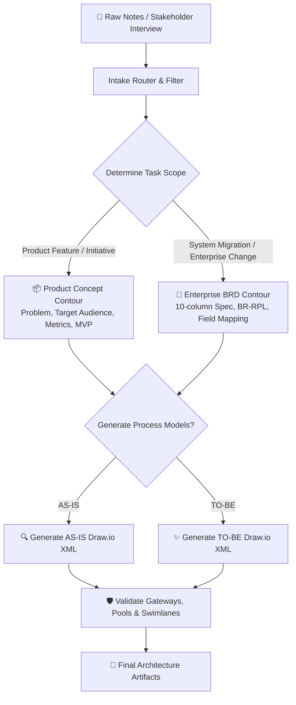
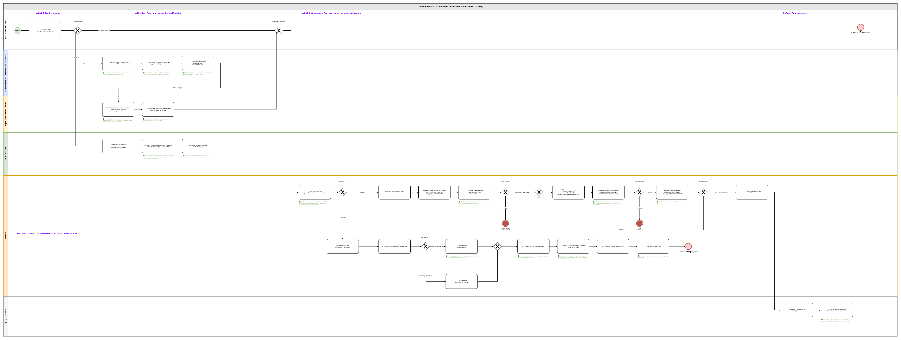

<div align="center">

# 🤖 AI BRD & Draw.io BPMN Process Generator

**Intelligent Business Analyst assistant for automated requirements gathering, standardized BRD generation, and production-ready BPMN 2.0 XML diagram synthesis for Draw.io.**

[](https://www.python.org/)
[](https://www.bpmn.org/)
[](https://app.diagrams.net/)
[](LICENSE)

[🇷🇺 Читать на русском](README.md) • [🇬🇧 Read in English](README.en.md)

---

</div>

## 📑 Table of Contents

1. [Problem Statement & Business Value](#1-problem-statement--business-value)
   * [1.1. The Business Analyst's Bottleneck](#11-the-business-analysts-bottleneck)
   * [1.2. AI Assistant Concept](#12-ai-assistant-concept)
2. [Dual-Contour Development Methodology](#2-dual-contour-development-methodology)
   * [2.1. "Product Concept" Contour (Product Ideation / IBDEV)](#21-product-concept-contour-product-ideation--ibdev)
   * [2.2. "BRD Specification" Contour (Enterprise Banking / FX / Radius)](#22-brd-specification-contour-enterprise-banking--fx--radius)
   * [2.3. AS-IS and TO-BE Process Modeling Pipeline](#23-as-is-and-to-be-process-modeling-pipeline)
3. [Draw.io Diagram Toolset (tools/)](#3-drawio-diagram-toolset-tools)
4. [Repository Structure](#4-repository-structure)
5. [Tech Stack](#5-tech-stack)
6. [Quick Start](#6-quick-start)
7. [Author & Contacts](#7-author--contacts)

---

## 1. Problem Statement & Business Value

### 1.1. The Business Analyst's Bottleneck
In large commercial banks and enterprise fintech environments, up to 50% of an analyst's time is consumed by repetitive manual chores: formatting requirements matrices, transcribing raw meeting notes into structured Business Requirements Documents (BRDs), and manually aligning pools, lanes, and gateway arrows in Draw.io.

### 1.2. AI Assistant Concept
**AI BRD & BPMN Generator** ingests raw meeting transcripts, brief notes, or stakeholder interview drafts and systematically compiles:
* Comprehensive, standardized business requirements specifications;
* Geometrically valid BPMN 2.0 `.drawio` XML files ready for instant rendering in desktop and browser diagram editors without manual layout fixing.

---

## 2. Dual-Contour Development Methodology



### 2.1. "Product Concept" Contour (Product Ideation / IBDEV)
* Product initiative page framework: problem statement, user segment profiling, business and product OKRs, MVP feature boundaries;
* Tailored for new offerings across ATM networks, teller cash desks, or digital retail fronts.

### 2.2. "BRD Specification" Contour (Enterprise Banking / FX / Radius)
* High-rigor banking specification format;
* Structured `BR-RPL` rule matrices (Business Requirement Rules), edge case handlers, field-level data transformations, error recovery mechanisms, and audit logging mandates.

### 2.3. AS-IS and TO-BE Process Modeling Pipeline
* Standardized swimlane separation: Client, Internal Operator, Front-end Platform, Integration Gateway, Core Back-office;
* Rigid validation of XOR/AND gateways with mutually exclusive output branch conditions (e.g., "Success / Failure").

<div align="center">

#### 📸 Sample Production BPMN 2.0 XML Diagram Synthesized for Draw.io


</div>

---

## 3. Draw.io Diagram Toolset (`tools/`)

The repository includes automation utilities in the `tools/` directory:
* `drawio2mermaid.py` — Converts Draw.io XML files into GitHub-flavored Mermaid diagrams;
* `drawiodiff.py` — Semantic AST-diff analyzer comparing visual and structural changes across schema versions during code reviews;
* `drawiohtml.py` — Standalone HTML preview generator for inline browser inspection;
* `encode_drawio_url.py` — Encodes diagram models into shareable deep-links.

---

## 4. Repository Structure

```text
09-ai-brd-bpmn-generator/
├── generator.py                  # Main CLI pipeline interface
├── prompts/                      # System prompts and modeling methodology
│   ├── brd_system_prompt.md      # Banking BRD generation rules
│   └── agent_contour.md          # Flow routing: Concept vs. Enterprise BRD
├── tools/                        # Diagram parsing, validation and export tools
│   ├── drawio2mermaid.py
│   ├── drawiodiff.py
│   ├── drawiohtml.py
│   └── encode_drawio_url.py
├── samples/                      # Production sample artifacts
│   ├── 01_шаблон_банкоматы.md
│   ├── 02_эталон_кассы.md
│   └── to be в банкоматах.drawio
├── requirements.txt              # Python dependencies
├── .gitignore                    # VCS ignore rules
├── README.md                     # Russian documentation
└── README.en.md                  # English documentation
```

---

## 5. Tech Stack

* `Python 3.10+`
* `Draw.io XML Schema` (mxGraph Model)
* `BPMN 2.0 Notation`
* `Mermaid.js`
* `LLM Prompt Engineering (Claude / ChatGPT / Gemini)`

---

## 6. Quick Start

```bash
git clone https://github.com/Andrew123485/ai-brd-bpmn-generator.git
cd ai-brd-bpmn-generator

python -m venv venv
.\venv\Scripts\activate
pip install -r requirements.txt

# Run generator with BRD contour
python generator.py --type brd --input samples/01_шаблон_банкоматы.md
```

---

## 7. Author & Contacts

* **Author:** Andrei Vladimirov
* **Specialization:** Business Analyst / Systems Analyst / Product Manager
* **Telegram:** [@amorfatimementomoria](https://t.me/amorfatimementomoria)
* **GitHub:** [github.com/Andrew123485](https://github.com/Andrew123485)
