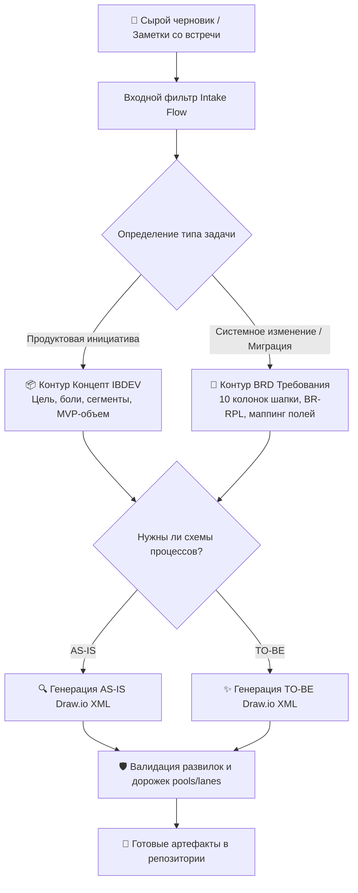

<div align="center">

# 🤖 AI BRD & Draw.io BPMN Process Generator

**Интеллектуальный ассистент бизнес-аналитика для автоматизированного сбора требований, формирования стандартизированных BRD-документов и генерации XML-схем процессов BPMN 2.0 под Draw.io.**

[](https://www.python.org/)
[](https://www.bpmn.org/)
[](https://app.diagrams.net/)
[](LICENSE)

[🇷🇺 Читать на русском](README.md) • [🇬🇧 Read in English](README.en.md)

---

</div>

## 📑 Содержание

1. [Проблема и ценность для бизнеса](#1-проблема-и-ценность-для-бизнеса)
   * [1.1. Боль бизнес-аналитика](#11-боль-бизнес-аналитика)
   * [1.2. Концепция AI-ассистента](#12-концепция-ai-ассистента)
2. [Методология двух контуров разработки](#2-методология-двух-контуров-разработки)
   * [2.1. Контур «Концепт продукта» (Product Ideation / IBDEV)](#21-контур-концепт-продукта-product-ideation--ibdev)
   * [2.2. Контур «BRD-требование» (Enterprise Banking / FX / Radius)](#22-контур-brd-требование-enterprise-banking--fx--radius)
   * [2.3. Алгоритм отрисовки процессов AS-IS и TO-BE](#23-алгоритм-отрисовки-процессов-as-is-и-to-be)
3. [Инструментарий работы со схемами Draw.io (tools/)](#3-инструментарий-работы-со-схемами-drawio-tools)
4. [Структура репозитория](#4-структура-репозитория)
5. [Стек технологий](#5-стек-технологий)
6. [Быстрый старт](#6-быстрый-старт)
7. [Автор и контакты](#7-автор-и-контакты)

---

## 1. Проблема и ценность для бизнеса

### 1.1. Боль бизнес-аналитика
В крупных банках и финтех-компаниях до 50% времени аналитика уходит на механическую работу: форматирование таблиц требований, ручной перенос сущностей из интервью в документ BRD (Business Requirements Document) и кропотливое выравнивание блоков и стрелок в Draw.io.

### 1.2. Концепция AI-ассистента
**AI BRD & BPMN Generator** берет на вход черновик, заметки со встречи или бриф заказчика и по строгому стандарту генерирует:
* Комплектные спецификации бизнес-требований;
* Валидный XML-код диаграмм BPMN 2.0 (`.drawio`), который открывается в десктопном или веб-клиенте Draw.io без ошибок геометрии.

---

## 2. Методология двух контуров разработки



### 2.1. Контур «Концепт продукта» (Product Ideation / IBDEV)
* Каркас страницы инициативы: формулировка проблемы, целевая аудитория, метрики успеха, MVP-функционал;
* Применяется для новых сервисов в кассах, банкоматах или цифровых витринах.

### 2.2. Контур «BRD-требование» (Enterprise Banking / FX / Radius)
* Стандартизированная банковская структура требований;
* Матрицы требований `BR-RPL` (Business Requirement Rule), сценарии альтернативных веток, правила обработки ошибок и аудит логов.

### 2.3. Алгоритм отрисовки процессов AS-IS и TO-BE
* Разделение дорожек (Swimlanes): Клиент, Внутренний оператор, Фронт-система, Шлюз интеграции, Бэк-офис;
* Строгие правила валидации шлюзов (Exclusive Gateway): наличие четких условий на исходящих потоках («Да / Нет»).

---

## 3. Инструментарий работы со схемами Draw.io (`tools/`)

В папке `tools/` размещены скрипты автоматизации диаграмм:
* `drawio2mermaid.py` — конвертер диаграмм Draw.io XML в разметку Mermaid для вставки в Markdown;
* `drawiodiff.py` — семантический диффер для сравнения изменений между версиями схем при код-ревью;
* `drawiohtml.py` — рендеринг интерактивного веб-просмотрщика схем прямо в браузере;
* `encode_drawio_url.py` — кодирование диаграмм в URL для мгновенного шеринга.

---

## 4. Структура репозитория

```text
09-ai-brd-bpmn-generator/
├── generator.py                  # Главный CLI интерфейс контура
├── prompts/                      # Системные промпты и методологические правила
│   ├── brd_system_prompt.md      # Промпт формирования банковских BRD
│   └── agent_contour.md          # Логика разделения потоков Концепт vs BRD
├── tools/                        # Скрипты парсинга, валидации и конвертации .drawio
│   ├── drawio2mermaid.py
│   ├── drawiodiff.py
│   ├── drawiohtml.py
│   └── encode_drawio_url.py
├── samples/                      # Эталонные артефакты
│   ├── 01_шаблон_банкоматы.md
│   ├── 02_эталон_кассы.md
│   └── to be в банкоматах.drawio
├── requirements.txt              # Зависимости Python
├── .gitignore                    # Исключения версионного контроля
├── README.md                     # Документация на русском
└── README.en.md                  # English documentation
```

---

## 5. Стек технологий

* `Python 3.10+`
* `Draw.io XML Schema` (mxGraph Model)
* `BPMN 2.0 Notation`
* `Mermaid.js`
* `LLM Prompt Engineering (Claude / ChatGPT / Gemini)`

---

## 6. Быстрый старт

```bash
git clone https://github.com/Andrew123485/ai-brd-bpmn-generator.git
cd ai-brd-bpmn-generator

python -m venv venv
.\venv\Scripts\activate
pip install -r requirements.txt

# Запуск генератора с типом BRD
python generator.py --type brd --input samples/01_шаблон_банкоматы.md
```

---

## 7. Автор и контакты

* **Автор:** Владимиров Андрей Георгиевич
* **Специализация:** Бизнес-аналитик / Системный аналитик / Продакт-менеджер
* **Telegram:** [@amorfatimementomoria](https://t.me/amorfatimementomoria)
* **GitHub:** [github.com/Andrew123485](https://github.com/Andrew123485)
