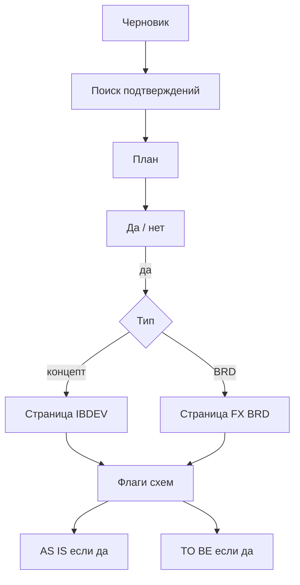

# Два контура: концепт продукта и BRD

Кассы и банкоматы — **концепт продукта** (страница IBDEV: ячейки идеи, проблема, цель, ЦА). Пункты у них уже **разные**, общее только каркас. Маркап — **BRD-требование** стрима FX (шапка из 10 колонок, назначение, концепт задачи, таблица `BR-RPL`). Это не один шаблон с другими фактами.

В [ВВОДНЫЕ_проекта.md](C:\Users\Андрейcursor\альфа банк brd и проекты\ВВОДНЫЕ_проекта.md) первое поле: **тип документа** — `концепт IBDEV` или `BRD (FX)`. Дальше грузятся только файлы этой ветки. Крипта по умолчанию — концепт. Перенос экрана в Radius — BRD.

Порядок один: черновик (дыры нормальны) → поиск подтверждений → план → стоп → страница выбранного типа → схемы, если флаги AS IS / TO BE. Скрины для «как рисовать» не нужны: есть [07_правила_AS_IS_TO_BE.md](C:\Users\Андрейcursor\альфа банк brd и проекты\07_правила_AS_IS_TO_BE.md). Имя `09_ВВОДНЫЕ.md` не существует; бланк — [ВВОДНЫЕ_проекта.md](C:\Users\Андрейcursor\альфа банк brd и проекты\ВВОДНЫЕ_проекта.md).

## Два пакета, не одна куча

**Пакет концепта** (кассы / банкоматы / крипта):

1. [ПАКЕТ.md](C:\Users\Андрейcursor\альфа банк brd и проекты\ПАКЕТ.md) — только эта ветка
2. [ПОРЯДОК.md](C:\Users\Андрейcursor\альфа банк brd и проекты\ПОРЯДОК.md)
3. [ПРАВИЛА_концепт.md](C:\Users\Андрейcursor\альфа банк brd и проекты\ПРАВИЛА_концепт.md)
4. [02_эталон_кассы.md](C:\Users\Андрейcursor\альфа банк brd и проекты\02_эталон_кассы.md) — вид ячеек, факты касс не копировать
5. [ЗАПОЛНЕННАЯ_страница_банкоматы_v4.md](C:\Users\Андрейcursor\альфа банк brd и проекты\ЗАПОЛНЕННАЯ_страница_банкоматы_v4.md) — плотность заполнения, факты АТМ не копировать
6. [01_шаблон_банкоматы.md](C:\Users\Андрейcursor\альфа банк brd и проекты\01_шаблон_банкоматы.md) — каркас без чужих ссылок IBDEV
7. `07` + эталоны drawio
8. Вводные этой задачи

**Пакет BRD** (маркап и похожие переносы FX):

1. [PLbymarkup/МАНИФЕСТ_PLbyMarkup.md](C:\Users\Андрейcursor\альфа банк brd и проекты\PLbymarkup\МАНИФЕСТ_PLbyMarkup.md)
2. [PLbymarkup/BRD-PLbyMarkup-Radius.md](C:\Users\Андрейcursor\альфа банк brd и проекты\PLbymarkup\BRD-PLbyMarkup-Radius.md) — эталон **точности**, не факты чужого продукта в новую задачу
3. Новый файл выводов по маркапу (удалили / перефразировали / уточнили)
4. Правило [plbymarkup.mdc](C:\Users\Андрейcursor\альфа банк brd и проектыcursor\rules\plbymarkup.mdc) текстом в пакет, без `.cursor` в контуре
5. `07` для схем; AS IS не рисовать, если процесса в целевой системе нет
6. Эталон шапки FX R_25 — в папке его нет, в зазор

В концепт не грузить маркап. В BRD не грузить ячейки «проблема / цель / ЦА / ценность» и пакет привлечения касс.

## Концепт: пункты касс и банкоматов уже разные

Общий каркас IBDEV: лейбл `ibprod_`, глоссарий, шапка владелец/PM/BA, таблица «Содержит следующие разделы», дальше BRD на той же странице.

Не делать объединение всех заголовков касс и банкоматов. На новой задаче (крипта) — каркас + **только те разделы, которые нужны этому продукту**.

| Есть у касс, у банкоматов иначе                    | Что делать агенту                                       |
| -------------------------------------------------- | ------------------------------------------------------- |
| «Выявленные проблемы (по результатам CJM)»         | CJM — только если просили. Банкоматы: заголовок без CJM |
| Бэклог и «связанные задачи вне scope»              | Не тащить с касс пустым пакетом                         |
| Длинный реестр НПА (вывоз, санкции, 136-Ф целиком) | У банкоматов короче: норма + зачем на этой странице     |
| Ломаный `[Table:]` в ячейках                       | Вид касс, таблицы ЦА — как у банкоматов v4              |
| Insight + Loss Points над таблицей разделов        | Как у банкоматов v4, не выдумывать ROI                  |

Первая выдача банкоматов vs конечный вид — в правила концепта (классы ошибок, без курса 84,45): не писать «нет» если есть; «уже есть» не в цель; два пути не сливать; не копировать владельцев/НПА/GROW касс; комиссия в курсе — строки клиенту нет; 53-ФЗ vs 136-И; на странице нет дат скринов, номеров АТМ, «в бою».

## BRD маркап: не «список не надо», а уровень проработки

Сверять три слоя, не один чат:

- Первая выдача ИИ (если дампа нет — восстановить по [ИНСТРУКЦИЯ_И_ПРАВКИ_BRD_ИЗ_ВИДЕО.md](C:\Users\Андрейcursor\альфа банк brd и проекты\PLbymarkup\ИНСТРУКЦИЯ_И_ПРАВКИ_BRD_ИЗ_ВИДЕО.md) и следам в txt)
- [законченный вид маркапа.txt](C:\Users\Андрейcursor\альфа банк brd и проекты\PLbymarkup\законченный вид маркапа.txt) — уже сильно резали и переписывали руками, но там ещё черновые куски
- [BRD-PLbyMarkup-Radius.md](C:\Users\Андрейcursor\альфа банк brd и проекты\PLbymarkup\BRD-PLbyMarkup-Radius.md) — более точный слой после видео

Цель файла выводов: ИИ следующей задачи сразу пишет **в плотности конечного BRD**, а не «сначала длинно, потом вырежем».

**Что вырезали** (в конечный документ это не возвращать):

- Пустые заголовки и пустые строки таблиц («Структура продукта» без схемы, пропуски в BR)
- «Переносится как есть» про AD.PrintForms / AD.Notifications
- Повтор «клиента в банке здесь не создаёт» в каждом абзаце
- Техсделки FX РКО / «другая задача» внутри концепта этого отчёта
- Колонка «вариант использования»; комментарии «не выдумывать» внутри BR
- Красные сомнения и размытые ID
- Определение «обработана» через OutDealServer источника — в Radius это RealMarkUp
- Склейка «Excel и письмо одной кнопкой» в обзоре

**Что перефразировали точнее** (каждое предложение делает одну работу):

- Роль везде одна: «сотрудник Sales», не дилер / sales / Банк
- Bid/Ask → **курсы** Bid/Ask; Voice_corp / COMM → портфель **Voice Corp**; C-TRAMP-эссе → колонка **CTramp** в opicsPLUS
- «Примерно совпадёт» → сопоставим, не копейка в копейку
- PIN нет в справочнике: не «как other» в отчёте, а «сделка всё равно в отчёте»; other в справочнике — другое место
- Три канала выгрузки раздельно: кнопка открывает файл; кнопки СКБ/КИБ; расписание на **группу рассылки**
- Deal Type: первым пустое значение = ещё не смотрели; список редактируют Sales
- Два процесса на схеме, не один конвейер «справочник сразу рождает сделку»
- Формулы USD: в гриде деление, в FSD умножение — открытый вопрос SA, не прятать и не выбирать за них
- Похожесть интерфейса — приоритет СРЕДНИЙ; данные — ВЫСОКИЙ
- Отрицательные определения оставлять один раз: не сделка, не карточка, не бухгалтерия

**Плотность:** таблица «что можно менять», список колонок, фильтры, отказ по трём независимым условиям, тексты подтверждения удаления — это контракт для SA. Вода, повтор очевидного, имена таблиц Radius, которые никто не называл — нет.

В пакет концепта эти факты Radius не класть. В пакет BRD класть **приёмы** (вырезать пустое, не сливать кнопки, одно имя роли, открытый вопрос не закрывать догадкой).

## Схема-конструктор (как на скрине AIBA, но наши файлы)

Нужна картинка того же типа, что на Confluence «AI ассистент BA»: сверху база, в середине запрос → оркестратор → ответ, снизу слоты. Слоты — не чужие агенты 1–5, а **детали конструктора**: какой файл за что отвечает и в какой пакет его класть.

**Куда рисуем.** Сначала Miro (через подключённый Miro): доску можно двигать руками после сдачи. Если доска не создастся — тот же макет в draw.io в корне проекта, чтобы файл жил рядом с пакетом. Идеально оба: Miro для правки, drawio как копия в гите.

Макет:

1. **Информационная база** (верх, как «доступ к Confluence / слой знаний»):
   - `ПОРЯДОК.md` — когда план, когда страница, когда схемы
   - `ПАКЕТ.md` — оглавление, что грузить, чего не грузить
   - `ВВОДНЫЕ_проекта.md` — черновик человека на **эту** задачу (не в эталон)
2. **Оркестратор** (розовый): читает поле «тип документа» и флаги AS IS / TO BE; не пишет страницу до «да»
3. **Слот концепт IBDEV** (кассы, банкоматы, крипта) — класть только сюда:
   - `ПРАВИЛА_концепт.md` — как писать страницу
   - `02_эталон_кассы.md` — вид ячеек, факты касс не копировать
   - `ЗАПОЛНЕННАЯ_страница_банкоматы_v4.md` — плотность заполнения, факты АТМ не копировать
   - `01_шаблон_банкоматы.md` — каркас
   - выводы концепта (ошибки первой выдачи банкоматов)
4. **Слот BRD FX** (маркап) — класть только сюда:
   - манифест + эталон точности `BRD-PLbyMarkup-Radius.md`
   - выводы: что вырезали и как ужесточили формулировки
   - не класть ячейки «проблема / цель / ЦА»
5. **Слот схем** (общий, как их агент №4):
   - `07_правила_AS_IS_TO_BE.md` — как рисовать
   - каркас касс + заполненные банкоматы drawio
   - вход: страница-истина; выход: AS IS и/или TO BE по флагу
6. **Поиск** (как их агент №5): не файл пакета, а шаг — интернет здесь / Confluence в контуре; в страницу только с источником

На каждой карточке три строки: **файл** / **за что** / **куда пихать** (пакет концепта / пакет BRD / общий / только на задачу). Жёлтые стикеры — подпроцессы, как «транскрибация / поиск страницы» у них: у нас «поиск подтверждений» и «стоп на плане».

Чужих ящиков «Роберт / Хелен / Пётр» не рисуем, пока это не ваши интеграции.

## Что человеку на задачу

1. Тип: концепт или BRD
2. Черновик в [ВВОДНЫЕ_проекта.md](C:\Users\Андрейcursor\альфа банк brd и проекты\ВВОДНЫЕ_проекта.md)
3. Флаги AS IS да/нет, TO BE да/нет
4. Для BRD FX — эталон R_25, когда появится файл

Не класть в чужую ветку: `папап.txt`, GROW, v3, G-шники как шаблон, always-on факты банкоматов в пакет крипты.

## Что не делаем

- Один промпт на оба шаблона
- Собирать все разделы касс «на всякий случай» в концепт банкоматов или крипты
- Туториал аналитику
- Копировать агентов 1/3 AIBA (вопросы к интервью, тест-кейсы), пока вы их не запросите
- Трогать `.cursor/plans`

